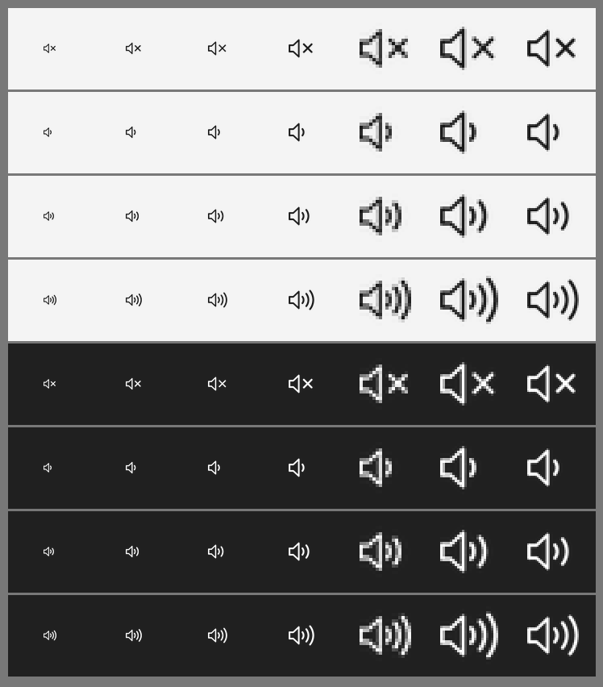

# 🔊 Sonic Tray

<p align="center">
  
</p>

<p align="center">
  <strong>Windows 系统静音状态托盘指示器</strong><br>
  轻量 · 纯粹 · 零依赖 · 毫秒级原生事件响应
</p>

<p align="center">
  <a href="https://github.com/kunkunkunQoQ/SonicTray/releases/latest"></a>
  
  
  
  
  <a href="LICENSE"></a>
</p>

---

## 📖 简介

**Sonic Tray** 是一款面向 Windows 平台打造的高性能、极简静音状态托盘指示工具。程序后台常驻且无主窗口干扰，在系统任务栏通知区域以原生视觉风格图标实时指示当前默认音频设备的「正常 / 静音」状态。

该工具严格遵循**纯状态监听**原则，**不主动修改、不干涉**任何系统音量与音频设备设置，在保持极致克制的同时，提供稳定敏捷的状态反馈。

---

## 🎯 开发背景：为什么需要 Sonic Tray？

在深度使用与定制 Windows 系统的场景中，很多用户常常会遇到这样的情况：

1. **精简优化后的状态缺失**：在采用精简版 Windows 系统镜像，或通过策略组、注册表及第三方任务栏工具深度精简、隐藏了原生音频控制中心（Action Center / 系统音量托盘图标）后，系统托盘便彻底失去了展示声音状态的视觉入口。
2. **多工具协同的指示盲区**：许多用户习惯搭配使用专注于音量微调或音频路由的第三方软件，亦或完全通过物理旋钮、全局快捷键控制音量，此时常驻的原生音量图标往往被收起或隐藏；但在误触静音快捷键或音量归零时，极难在第一时间察觉，经常造成“以为声卡断开、排查半天才发现被静音”的困扰。

**Sonic Tray 专为填补这一体验断层而生：**

- **精准补足指示，不做多余干涉**：它不是庞大臃肿的音量控制面板，而是一颗专职的“状态指示灯”。在原生音量组件被精简、移除后，无缝替代并补全系统的静音指示能力。
- **与精简系统相得益彰**：无 GUI 框架冗余、零后台开销，在享受精简清爽界面的同时，找回最核心、最直观的静音状态感知。

---

## ✨ 核心特性

- 🎧 **静音与音量状态直观感知**：实时监听系统默认播放设备，按音量在「静音 / 低 / 中 / 高」四档原生设计图标间切换（1–33 低、34–66 中、67–100 高，0% 与静音同显示）；悬停可见精确百分比。
- ⚡ **单文件免安装，纯静态运行**：采用 Rust 编写并开启 MSVC 静态 CRT 链接，单个 `SonicTray.exe`（约 470 KB）开箱即用，运行时无需安装 VC++ 运行库、.NET 或 Python。
- 💤 **事件驱动，闲时 0 开销**：深度接入 Windows Core Audio COM 回调机制与 Win32 消息循环，状态仅在系统音频事件触发时被动更新，日常待机 CPU 占用接近 0，告别高频轮询。
- 🎨 **自适应高 DPI 与深浅主题**：
  - 图标采用多尺寸单独光栅化绘制（16/20/24/32/40/48/64 像素），无论何种屏幕缩放比例边缘均清晰锐利。
  - 自动适配 Windows 任务栏浅色 / 深色主题，接收系统主题广播即时无感重绘。
- 🚀 **绿色开机自启**：右键菜单提供便捷的自启动开关，直接写入当前用户注册表（`HKCU Run`），无需管理员提权，不触碰系统任务计划程序。
- 🛡️ **单实例与容错机制**：基于命名互斥体防止多开，重复启动静默退出；具备默认音频设备热插拔自动重新绑定及 Explorer 崩溃重启补登机制。

---

## 📥 获取与运行

### 方式 1：直接下载发布包
访问 **[GitHub Releases 最新版本](https://github.com/kunkunkunQoQ/SonicTray/releases/latest)** 下载已编译的 `SonicTray.exe` 或压缩包。

### 方式 2：仓库自带可执行文件
克隆本仓库后，直接双击运行工程根目录下的 [publish/SonicTray.exe](publish/SonicTray.exe)。

> [!NOTE]
> - 启动后无任何前台窗口或控制台黑框，直接常驻于任务栏通知区域。
> - Windows 11 默认可能将新图标收纳在折叠区域中，可点击任务栏 `^` 查看，或在系统「任务栏设置 → 其他系统托盘图标」中将其设为常显。

---

## 🖱️ 交互说明

| 操作 | 响应行为 |
|---|---|
| **鼠标悬停** | 显示当前音量：`系统音量：48%`；静音时为 `系统已静音（65%）` |
| **鼠标左键** | 无动作（纯状态指示，保持克制，不弹出多余窗口干扰） |
| **鼠标右键** | 弹出功能菜单：`开机自启`（勾选状态）、`清除开机自启`、`退出` |

---

## ⚙️ 核心机制与技术细节

### 1. 状态判断规则

```text
静音标志为 true || 百分比为 0   ->  静音（扬声器 + X）
1%  ~ 33%                       ->  低（1 道声波）
34% ~ 66%                       ->  中（2 道声波）
67% ~ 100%                      ->  高（3 道声波）
```

| 系统实际状态 | 托盘图标 | 悬停提示 |
|---|---|---|
| 音量 15%，未静音 | 低（1 道声波） | `系统音量：15%` |
| 音量 50%，未静音 | 中（2 道声波） | `系统音量：50%` |
| 音量 100%，未静音 | 高（3 道声波） | `系统音量：100%` |
| 音量 0%，未开启静音标志 | 静音 | `系统音量：0%` |
| 音量 65%，开启静音标志 | 静音 | `系统已静音（65%）` |
| 取消静音且音量 > 0 | 立即回到对应档位 | 对应百分比 |

*注：静音优先于任何音量；音量为 0 仅影响托盘图标的视觉提示，程序绝不会主动写入系统的静音状态标志。分界 33/66 为本项目近似值。*

### 2. 线程与事件架构

- **主线程（STA）**：负责 Win32 消息泵、创建隐藏窗口、托盘图标刷新与右键菜单响应。
- **Core Audio 回调**：
  - 音量/静音变动：`IAudioEndpointVolumeCallback::OnNotify` $\rightarrow$ 发送 `WM_AUDIO_CHANGED` 消息通知主线程更新。
  - 默认设备切换：`IMMNotificationClient::OnDefaultDeviceChanged` $\rightarrow$ 自动注销旧设备监听并无缝绑定新设备。
- **任务栏重建**：监听 `TaskbarCreated` 系统广播，当资源管理器重启时自动补登图标，杜绝托盘图标丢失。
- **零轮询**：不使用任何定时器或轮询，空闲时无唤醒；状态变化只由 Core Audio 回调、设备通知与系统广播触发。等级未变化时不重设图标，仅在百分比变化时更新一条 `NIF_TIP` 提示。

### 3. 开机自启机制

- **写入项**：`HKEY_CURRENT_USER\Software\Microsoft\Windows\CurrentVersion\Run`
- **路径校验**：仅当注册表中存在键名且指向当前 EXE 的实际路径时，菜单才标记为勾选。若 EXE 发生移动，重新勾选一次即可无损刷新路径。
- **彻底清除**：「清除开机自启」会按 `SonicTray` 键名精准清理，即使原可执行文件已移动或删除也能干净清除残留注册表项。

---

## 📁 目录结构

```text
SonicTray/
├── Cargo.toml              # 项目依赖与发布配置
├── Cargo.lock              # 精确版本锁定
├── build.rs                # 构建脚本（编译 app.rc 图标与版本资源）
├── LICENSE                 # MIT 开源许可证
├── .cargo/
│   └── config.toml         # MSVC 静态 CRT 链接配置
├── src/
│   ├── main.rs             # 入口、隐藏窗口、消息分发与主状态机
│   ├── audio.rs            # Core Audio 监听与状态判定
│   ├── tray.rs             # Shell_NotifyIconW 封装与菜单处理
│   ├── icons.rs            # ICO 资源提取、DPI 适配与主题响应
│   ├── startup.rs          # HKCU Run 开机启动项注册与管理
│   └── single_instance.rs  # Windows 命名互斥体
├── assets/                 # ICO 资源文件与 Windows 资源描述文件 (.rc)
├── tools/                  # 资源生成工具（包含图标超采样生成脚本与预览图）
├── publish/                # 预编译单文件发布物
└── README.md
```

---

## 🛠️ 本地构建

如果你希望自行从源码构建项目，请确保本地具备 **Rust Stable** 环境与 **MSVC Build Tools (Windows SDK)**：

```bash
# 1. 运行单元测试（测试状态判定逻辑、ICO 尺寸提取与自启往返）
cargo test

# 2. 编译发布版本（优化体积、开启 LTO 与符号裁剪）
cargo build --release
```

编译产物位于 `target/release/SonicTray.exe`。

---

## 📄 开源许可证

本项目基于 [MIT 许可证](LICENSE) 开源。
